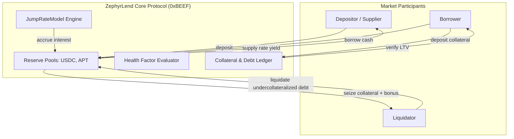

# ZephyrLend

[](https://github.com/ZengLLQ/zephyr-lend/actions)
[](https://opensource.org/licenses/MIT)
[](https://aptos.dev/)
[](https://aptos.dev/)

**ZephyrLend** is a high-performance decentralized money market and collateralized lending protocol built in Move for Aptos 2.0. It features isolated reserve pools, a continuous jump-rate interest model with piecewise utilization regimes, dynamic health factor monitoring, and an incentivized liquidation engine with automated reserve protocol fee harvesting.

---

## Economic & Mathematical Specification

### 1. Utilization Rate $U$

For any reserve holding liquid cash $C$, total borrows $B$, and protocol accumulated reserves $R_{\text{res}}$:

$$
U = \frac{B}{C + B - R_{\text{res}}} \in [0, 1]
$$

### 2. Piecewise Jump-Rate Interest Model

Borrow interest rate $R_{\text{borrow}}(U)$ transitions past an optimal target utilization $U_{\text{kink}}$:

$$
R_{\text{borrow}}(U) = \begin{cases}
R_0 + U \cdot \frac{R_{\text{multiplier}}}{U_{\text{kink}}}, & U \le U_{\text{kink}} \\
R_0 + R_{\text{multiplier}} + \left(\frac{U - U_{\text{kink}}}{1 - U_{\text{kink}}}\right) \cdot R_{\text{jump}}, & U > U_{\text{kink}}
\end{cases}
$$

Where:
- $R_0$: Base annual borrowing interest rate.
- $R_{\text{multiplier}}$: Linear slope coefficient below kink.
- $R_{\text{jump}}$: Steep penalization slope multiplier above kink.
- $U_{\text{kink}}$: Target threshold utilization (typically 80%).

Supplier interest rate accounts for utilization and protocol reserve cut $\gamma_{\text{res}}$:

$$
R_{\text{supply}}(U) = U \cdot R_{\text{borrow}}(U) \cdot (1 - \gamma_{\text{res}})
$$

### 3. Continuous Compounding Borrow Index

Over time elapsed $\Delta t = t - t_{\text{last}}$, the cumulative borrow index $I_b(t)$ compounds:

$$
I_b(t) = I_b(t_{\text{last}}) \cdot \left(1 + \frac{R_{\text{borrow}}}{31{,}536{,}000} \cdot \Delta t\right)
$$

### 4. Health Factor & Liquidation Invariant

For borrower account $u$, the composite Health Factor $H_u$ is defined as:

$$
H_u = \frac{\sum_{i} \Big(\text{Collateral}_{u, i} \times P_i \times \text{LT}_i\Big)}{\sum_{j} \Big(\text{Debt}_{u, j} \times P_j\Big)}
$$

Where $\text{LT}_i$ is the liquidation threshold (e.g. 80%). When $H_u < 1.0$, third-party liquidators can repay up to the close factor of outstanding debt in exchange for collateral with liquidation incentive bonus $\beta_{\text{liq}}$:

$$
\text{Seized Collateral} = \frac{\text{Repaid Debt} \times P_{\text{debt}} \times (1 + \beta_{\text{liq}})}{P_{\text{collateral}}}
$$

---

## Protocol Architecture



---

## Module Layout

```
sources/
├── fixed_point.move     # High-precision fixed-point WAD arithmetic and overflow guards
├── interest_model.move  # Piecewise jump-rate interest curves and per-second compounding
├── oracle.move          # Multi-asset price feed registry
└── pool.move            # Lending reserves, deposits, borrows, repayments, and liquidations
tests/
└── lending_tests.move   # Unit and integration scenario tests verifying all economic transitions
```

---

## Build & Test

```bash
# Compile Move packages
aptos move compile

# Run complete Move test suite
aptos move test
```

---

## License

This project is licensed under the [MIT License](LICENSE).
